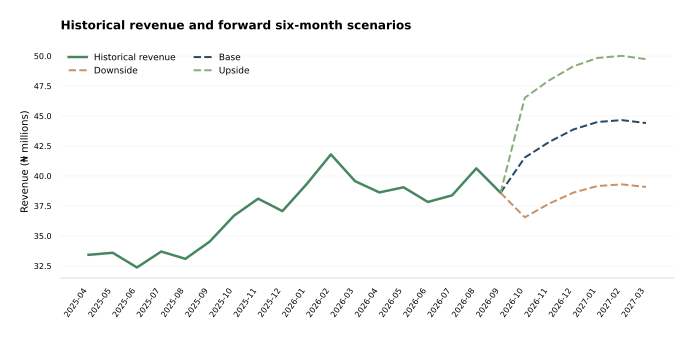

# Financial Performance & Cash Flow Forecasting

**Revenue backtesting, liquidity forecasting and scenario sensitivity**

**[View the published case study](https://godspowerjohn.github.io/financial-data-portfolio/projects/cashflow-forecast/)** · [Back to the portfolio overview](../../README.md)

> **Data provenance:** A reproducible portfolio demonstration using artificial, synthetic data. The metrics below are results of that simulation, not real employer, client, bank or production data.

## 1. Business problem

How can a finance team evaluate revenue forecast accuracy and understand how downside conditions could affect available cash?

## 2. Data and method

36 synthetic months of revenue, operating costs, EBITDA, capital expenditure and working-capital movements.

I trained a trend-and-seasonality revenue model using 30 months, evaluated it on a subsequent six-month holdout, then projected six future months. The base, upside and downside cash scenarios apply transparent revenue and cost assumptions.

## 3. Results that matter

| Measure | Simulated result |
| --- | ---: |
| Historical period | 36 months |
| Revenue backtest | 6 held-out months |
| Revenue MAE | ₦764,902 |
| Latest illustrative closing cash | ₦322.16 million |
| Month-six downside cash | ₦382.92 million |
| Month-six base cash | ₦401.27 million |
| Month-six upside cash | ₦419.63 million |



The held-out revenue error gives one estimate of historical forecasting fit. The ₦18.35 million gap between the downside and base month-six cash scenarios highlights sensitivity to revenue assumptions; it does not measure a prediction interval or probability of either outcome.

## 4. Business recommendation

Tie forecasts to receivables, payment schedules and committed expenses, add a rolling 13-week view for near-term cash needs, and stress-test working-capital and expense assumptions.

## 5. Limitations

All values are simulated. The model assumes relatively stable seasonality, cash conversion and cost relationships. Scenarios are not probability-weighted and do not forecast an actual business.

## 6. Reproduce the analysis

Install the shared project requirements and run the project script from the **repository root** using Python 3.10+:

```bash
python -m pip install -r projects/requirements.txt
python projects/cashflow-forecast/src/run.py
```

The script uses a fixed random seed and regenerates synthetic outputs. Verify the figures against [`results/metrics.json`](results/metrics.json); open [`results/summary.svg`](results/summary.svg) to inspect the generated chart.

## 7. Files and deliverables

- [Dataset](data/monthly_financials.csv)
- [Python analysis](src/run.py)
- [PostgreSQL exploration](src/analysis.sql)
- [Calculated metrics](results/metrics.json)
- [Chart output](results/summary.svg)
- [Power BI DAX measures](powerbi/measures.dax)
- [Power BI report specification and quality checks](powerbi/REPORT_SPEC.md)

**Power BI status:** DAX measures and report-building guidance are included. No completed native `.pbix` report is claimed here.

---

**Professional portfolio:** [Godspower Johnson](https://godspowerjohn.github.io/financial-data-portfolio/) · [All five projects](../../README.md)
