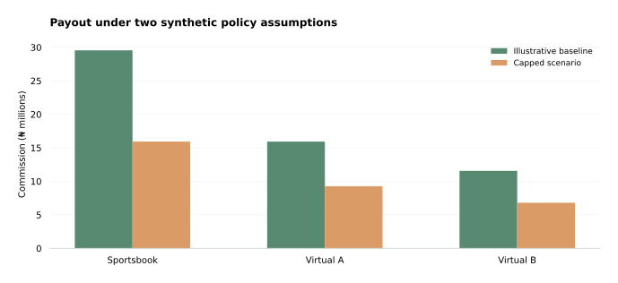

# Agent Commission Profitability & Cost Optimisation

**Comparing incentive policies against contribution-margin protection**

**[View the published case study](https://godspowerjohn.github.io/financial-data-portfolio/projects/commission-profitability/)** · [Back to the portfolio overview](../../README.md)

> **Data provenance:** A reproducible portfolio demonstration using artificial, synthetic data. The metrics below are results of that simulation, not real employer, client, bank or production data.

## 1. Business problem

How does changing a commission policy affect payout costs, commission-to-GGR ratios and the number of loss-making agent periods?

## 2. Data and method

720 simulated agent-month observations representing 80 agents over nine months. Each observation contains simulated stakes, GGR and commission-related quantities by product.

I compared an invented qualifying 5% stake-linked payout with a 30% positive-GGR monthly floor against a hypothetical lower stake component and a 40% positive-GGR payout ceiling. I compared costs and loss-making agent-months across products.

## 3. Results that matter

| Measure | Simulated result |
| --- | ---: |
| Agent-month records | 720 |
| Baseline commission | ₦57.05 million |
| Scenario commission | ₦32.01 million |
| Illustrative payout difference | ₦25.04 million |
| Commission / positive GGR, baseline | 49.3% |
| Commission / positive GGR, scenario | 27.7% |
| Loss-making agent-months | 240 baseline → 135 scenario |



In the simulated data, the capped policy yields a lower calculated commission bill. That difference is a scenario result, not realised financial savings. An incentive change may also affect agent behaviour, retention and future transaction volumes, which this simulation does not estimate.

## 4. Business recommendation

Test policies by product and agent cohort, define margin guardrails and exception approval, and evaluate agent responses in a controlled pilot before making any commercial decision.

## 5. Limitations

All policy rules and observations are hypothetical. There is no measured causal relationship between the commission change and agent behaviour. The cost difference must not be presented as an achieved company result.

## 6. Reproduce the analysis

Install the shared project requirements and run the project script from the **repository root** using Python 3.10+:

```bash
python -m pip install -r projects/requirements.txt
python projects/commission-profitability/src/run.py
```

The script uses a fixed random seed and regenerates synthetic outputs. Verify the figures against [`results/metrics.json`](results/metrics.json); open [`results/summary.svg`](results/summary.svg) to inspect the generated chart.

## 7. Files and deliverables

- [Dataset](data/agent_months.csv)
- [Python analysis](src/run.py)
- [PostgreSQL exploration](src/analysis.sql)
- [Calculated metrics](results/metrics.json)
- [Chart output](results/summary.svg)
- [Power BI DAX measures](powerbi/measures.dax)
- [Power BI report specification and quality checks](powerbi/REPORT_SPEC.md)

**Power BI status:** DAX measures and report-building guidance are included. No completed native `.pbix` report is claimed here.

---

**Professional portfolio:** [Godspower Johnson](https://godspowerjohn.github.io/financial-data-portfolio/) · [All five projects](../../README.md)
