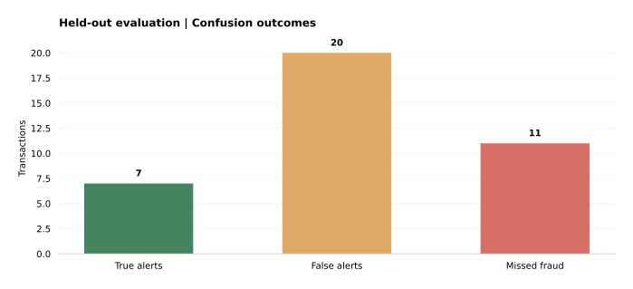

# Financial Fraud Detection & Risk Intelligence

**Transaction monitoring, risk scoring and investigation prioritisation**

**[View the published case study](https://godspowerjohn.github.io/financial-data-portfolio/projects/fraud-intelligence/)** · [Back to the portfolio overview](../../README.md)

> **Data provenance:** A reproducible portfolio demonstration using artificial, synthetic data. The metrics below are results of that simulation, not real employer, client, bank or production data.

## 1. Business problem

How can an investigation team identify more suspicious transactions while keeping false alerts within a manageable review queue?

## 2. Data and method

4,800 labelled, fully synthetic transactions. Features include transaction value, recent transaction frequency, device indicators, timing and cross-border indicators. There are 119 simulated fraud labels across the whole dataset.

I used a 60/20/20 chronological train/validation/test split, fitted a class-weighted logistic-regression classifier, selected the alert threshold using validation data and assessed the untouched test period against a simple rules-based baseline.

## 3. Results that matter

| Measure | Simulated result |
| --- | ---: |
| Test transactions | 960 |
| Test fraud cases | 18 |
| Model alerts raised | 27 |
| True fraud alerts | 7 |
| False alerts | 20 |
| Precision | 25.9% |
| Recall | 38.9% |
| Baseline rule precision / recall | 60.0% / 16.7% |



The model flagged 7 of 18 labelled fraud transactions in the held-out period, but 20 of its 27 alerts were false positives. The simpler comparison rule had better precision but caught fewer fraud cases. More alerts do not necessarily mean better operations; investigators must consider case capacity and the cost of missed fraud.

## 4. Business recommendation

Pilot an investigator review queue with explicit case priority, monitor precision and recall against review capacity, log investigation outcomes, and re-evaluate the threshold when transaction patterns change.

## 5. Limitations and Future Improvements

The analysis demonstrates a structured approach to fraud detection using simulated transaction data. Before deployment in a real financial environment, the model would require validation against actual transaction patterns, ongoing performance monitoring, and appropriate risk controls.

Future improvements could include additional behavioural indicators, improved fraud classification methods, and continuous model evaluation to reduce false alerts.

Because the transaction data and fraud labels are simulated, reported metrics are illustrative, not evidence of production performance. A flagged transaction requires investigation and does not establish wrongdoing.

## 6. Reproduce the analysis

Install the shared project requirements and run the project script from the **repository root** using Python 3.10+:

```bash
python -m pip install -r projects/requirements.txt
python projects/fraud-intelligence/src/run.py
```

The script uses a fixed random seed and regenerates synthetic outputs. Verify the figures against [`results/metrics.json`](results/metrics.json); open [`results/summary.svg`](results/summary.svg) to inspect the generated chart.

## 7. Files and deliverables

- [Dataset](data/transactions.csv)
- [Python analysis](src/run.py)
- [PostgreSQL exploration](src/analysis.sql)
- [Calculated metrics](results/metrics.json)
- [Chart output](results/summary.svg)
- [Power BI DAX measures](powerbi/measures.dax)
- [Power BI report specification and quality checks](powerbi/REPORT_SPEC.md)

**Power BI status:** DAX measures and report-building guidance are included. No completed native `.pbix` report is claimed here.

---

**Professional portfolio:** [Godspower Johnson](https://godspowerjohn.github.io/financial-data-portfolio/) · [All five projects](../../README.md)
