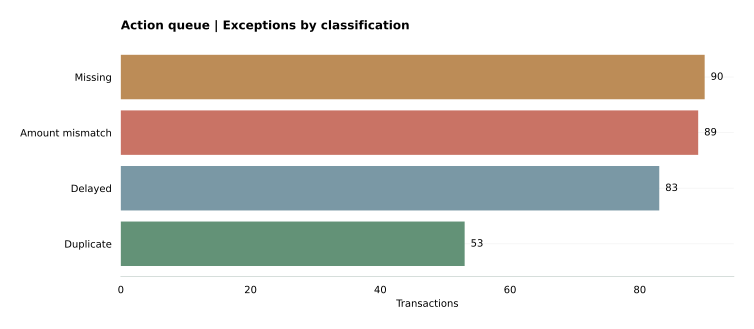

# Automated Payment Reconciliation & Exception Management

**Provider-to-bank matching, exception classifications and value at risk of delay**

**[View the published case study](https://godspowerjohn.github.io/financial-data-portfolio/projects/payment-reconciliation/)** · [Back to the portfolio overview](../../README.md)

> **Data provenance:** A reproducible portfolio demonstration using artificial, synthetic data. The metrics below are results of that simulation, not real employer, client, bank or production data.

## 1. Business problem

How can payment operations detect missing, duplicated, delayed or mismatched settlements before exceptions accumulate?

## 2. Data and method

2,100 synthetic payment-provider transactions and 2,063 synthetic bank-credit entries with reference identifiers, posting amounts and event times.

I joined provider and bank references, aggregated credit records to detect duplicates, and applied a prioritised set of exception classifications: missing, duplicate, amount mismatch, delayed and matched.

## 3. Results that matter

| Measure | Simulated result |
| --- | ---: |
| Provider transactions | 2,100 |
| Exactly matched | 1,785 (85.0%) |
| Exceptions for investigation | 315 |
| Missing / mismatch / delayed / duplicate | 90 / 89 / 83 / 53 |
| Unmatched expected amount | ₦20.79 million |
| Absolute unreconciled variance | ₦32.82 million |



A successful provider transaction is not the same as a verified bank credit. The simulated exceptions illustrate why transaction status, posting time, amount and duplicates must be assessed separately. Unmatched value and absolute variance are investigative measures, not audited losses.

## 4. Business recommendation

Assign exception owners, enforce settlement cutoffs and investigation SLAs, keep immutable source exports, and investigate high-value and aging differences first.

## 5. Limitations

The simulated records use simple reference-level matching. Production settlements can require many-to-many batch matching, fees, reversals, holidays and provider-specific settlement calendars.

## 6. Reproduce the analysis

Install the shared project requirements and run the project script from the **repository root** using Python 3.10+:

```bash
python -m pip install -r projects/requirements.txt
python projects/payment-reconciliation/src/run.py
```

The script uses a fixed random seed and regenerates synthetic outputs. Verify the figures against [`results/metrics.json`](results/metrics.json); open [`results/summary.svg`](results/summary.svg) to inspect the generated chart.

## 7. Files and deliverables

- [Dataset](data/reconciliation_output.csv)
- [Python analysis](src/run.py)
- [PostgreSQL exploration](src/analysis.sql)
- [Calculated metrics](results/metrics.json)
- [Chart output](results/summary.svg)
- [Power BI DAX measures](powerbi/measures.dax)
- [Power BI report specification and quality checks](powerbi/REPORT_SPEC.md)

**Power BI status:** DAX measures and report-building guidance are included. No completed native `.pbix` report is claimed here.

---

**Professional portfolio:** [Godspower Johnson](https://godspowerjohn.github.io/financial-data-portfolio/) · [All five projects](../../README.md)
