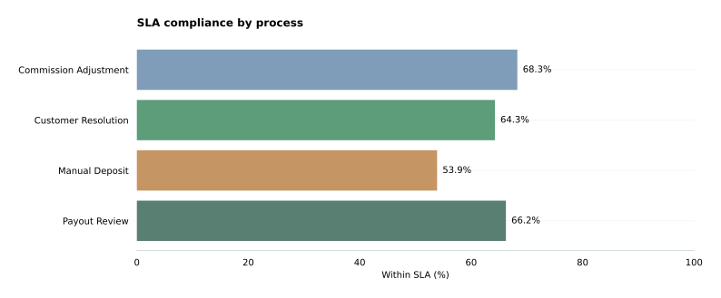

# Business Process Efficiency & Operational Performance

**SLA compliance, queue analysis, rework and process improvement**

**[View the published case study](https://godspowerjohn.github.io/financial-data-portfolio/projects/process-efficiency/)** · [Back to the portfolio overview](../../README.md)

> **Data provenance:** A reproducible portfolio demonstration using artificial, synthetic data. The metrics below are results of that simulation, not real employer, client, bank or production data.

## 1. Business problem

Which workflows miss their service targets, and how much might shorter queues improve overall performance?

## 2. Data and method

2,250 simulated service cases across manual deposits, payout reviews, commission adjustments and customer resolutions, including queue, handling and rework timings.

I separated queue from handling time, calculated SLA and rework rates by workflow, then estimated the effect of an illustrative 20% queue-time reduction without changing observed handling times.

## 3. Results that matter

| Measure | Simulated result |
| --- | ---: |
| Simulated cases | 2,250 |
| Overall SLA attainment | 61.6% |
| Average queue time | 10.03 minutes |
| Manual-deposit SLA attainment | 53.9% |
| Customer-resolution queue time | 25.65 minutes |
| What-if SLA attainment | 69.82% |
| Illustrative improvement | 8.22 percentage points |



The synthetic records indicate different causes of poor service: some workflows spend longer waiting, while others involve more rework. The proposed 20% queue reduction improves the modelled SLA from 61.6% to 69.82%, but that change has not been observed in a live operation.

## 4. Business recommendation

Map handoffs, record stage-level timestamps, separate queues from active work, and test one process redesign at a time against a pre-defined SLA and error baseline.

## 5. Limitations

The cases, targets and improvement scenario are synthetic. No real process has been changed, and the what-if calculation does not guarantee operational gains.

## 6. Reproduce the analysis

Install the shared project requirements and run the project script from the **repository root** using Python 3.10+:

```bash
python -m pip install -r projects/requirements.txt
python projects/process-efficiency/src/run.py
```

The script uses a fixed random seed and regenerates synthetic outputs. Verify the figures against [`results/metrics.json`](results/metrics.json); open [`results/summary.svg`](results/summary.svg) to inspect the generated chart.

## 7. Files and deliverables

- [Dataset](data/process_cases.csv)
- [Python analysis](src/run.py)
- [PostgreSQL exploration](src/analysis.sql)
- [Calculated metrics](results/metrics.json)
- [Chart output](results/summary.svg)
- [Power BI DAX measures](powerbi/measures.dax)
- [Power BI report specification and quality checks](powerbi/REPORT_SPEC.md)

**Power BI status:** DAX measures and report-building guidance are included. No completed native `.pbix` report is claimed here.

---

**Professional portfolio:** [Godspower Johnson](https://godspowerjohn.github.io/financial-data-portfolio/) · [All five projects](../../README.md)
